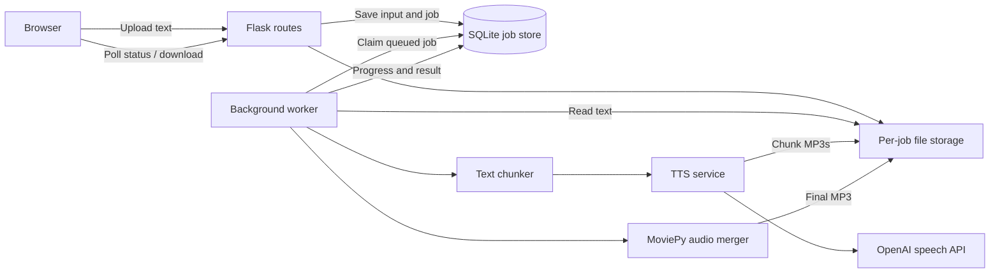

# Flask architecture for Romanian text to speech

## Purpose and scope

Build a Flask web app in this repository that turns an uploaded text file into a downloadable MP3. The app adapts the workflow in `text-to-speech-ro.ipynb`: split text into manageable chunks, call OpenAI text to speech for each chunk, and concatenate the generated audio in order.

Keep the notebooks as experiments. Extract production behavior into Python modules rather than executing the notebook from a web request. This document proposes the architecture; it does not implement the app.

## User experience

1. The user opens the upload page and selects a UTF-8 `.txt` file containing Romanian text.
2. The user clicks **Create MP3**. The page explains that the voice is AI generated.
3. The app validates the file and returns a job page with progress: queued, generating chunk X of Y, merging, or complete.
4. Once complete, the page presents an audio player and a **Download MP3** button. For `story.txt`, the download is named `story.mp3`.
5. If processing fails, the page gives a readable error and allows a new upload. It never offers a partial MP3 as a successful result.

Start with fixed settings matching the notebook's conversion calls: model `tts-1`, voice `onyx`, MP3 output. Keep these configurable on the server. A voice selector can be added later.

## Main components



Flask handles upload, status, and download requests. A separate worker performs the slow TTS and audio work. SQLite records durable job state, and a local filesystem stores inputs and audio. This is suitable for an initial single-host deployment with modest traffic.

Do not perform the conversion inside the upload request or start an unmanaged thread in a Flask route. Long conversions can exceed HTTP timeouts, and web process restarts would interrupt work without reliable tracking.

## Proposed directory structure

```text
openai-notebooks/
├── text-to-speech-ro.ipynb
├── transcribe-wav.ipynb
├── requirements.txt                 # Existing notebook environment
├── requirements-web.txt             # Flask app dependencies
├── README.md
├── .gitignore
├── .env.example                     # Configuration names; no credentials
├── docs/
│   └── flask-tts-architecture.md
├── tts_web/
│   ├── __init__.py                   # create_app() factory
│   ├── config.py
│   ├── routes.py                    # Upload, job page, status, download
│   ├── jobs.py                      # Persistence and state transitions
│   ├── worker.py                    # Worker entry point and job runner
│   ├── services/
│   │   ├── text.py                  # Decode, normalize, split
│   │   ├── speech.py                # OpenAI client and chunk generation
│   │   └── audio.py                 # Ordered merge and resource cleanup
│   ├── templates/
│   │   ├── base.html
│   │   ├── upload.html
│   │   └── job.html
│   └── static/
│       ├── app.css
│       └── job.js                   # Status polling and result display
├── tests/
│   ├── test_text.py
│   ├── test_routes.py
│   └── test_job_pipeline.py
└── instance/                        # Runtime data; excluded from Git
    ├── jobs.sqlite3
    └── jobs/
        └── <job-id>/
            ├── input.txt
            ├── chunks/
            │   ├── 000001.mp3
            │   └── 000002.mp3
            └── output.mp3
```

Keep the notebook files in their current locations. The new `tts_web/` package separates web behavior from experiments without restructuring the whole repo. Flask's instance directory holds deployment-specific data outside application source.

Use a separate `requirements-web.txt` containing Flask, OpenAI, MoviePy, and a production WSGI server such as Waitress for Windows support. Pin and validate versions when implementing. Add a CSRF protection dependency if using Flask forms. This avoids requiring PyTorch, scientific libraries, and Jupyter just to run the web app. SQLite is available through Python's standard library. MoviePy needs an available FFmpeg executable; verify that the installed `imageio-ffmpeg` distribution provides one for the deployment platform.

Add `instance/`, `.env`, and generated audio to `.gitignore`. Keep `.venv/` ignored as already configured.

## HTTP interface

| Method and path | Purpose | Result |
| --- | --- | --- |
| `GET /` | Show upload form | HTML form |
| `POST /jobs` | Validate multipart field `file` and create a job | `303` redirect to `/jobs/<job-id>` |
| `GET /jobs/<job-id>` | Show progress or result | HTML job page |
| `GET /api/jobs/<job-id>` | Read current state | JSON status and progress |
| `GET /jobs/<job-id>/audio` | Play the completed MP3 | `audio/mpeg`, inline disposition |
| `GET /jobs/<job-id>/download` | Download the completed MP3 | Attachment with safe original basename |

The upload route returns after validation and durable job creation. The browser polls status approximately every two seconds and stops at a terminal state. Status JSON includes `state`, `completed_chunks`, `total_chunks`, and a safe error message if applicable. URLs for playback and download appear only after completion.

Unknown or unauthorized job IDs return `404`. Requests for audio before completion return `409`. Oversized uploads return `413`; invalid or empty text returns `400` with an explanation. Store jobs under server-generated UUIDs, never under user-provided paths.

## Upload validation and text preparation

- Accept one `.txt` file per job. Validate decoded content rather than trusting the extension or browser MIME type.
- Start with a configurable 1 MiB upload limit and a separate 50,000-character text limit to bound work and API cost. These are proposed product defaults, not provider limits.
- Decode as UTF-8, allowing a UTF-8 BOM. Reject malformed input with a message explaining the expected encoding. Preserve Romanian diacritics.
- Normalize line endings and trim surrounding whitespace. Reject whitespace-only content and obvious binary content, including null bytes.
- Split at paragraph or sentence boundaries when possible, then at whitespace, with a hard split fallback for unusually long tokens. Never drop or reorder text.
- Use a configurable chunk size, initially 3,000 characters. Verify the selected model's input limit during implementation and ensure each chunk stays within it.

Unit tests should verify exact text coverage, ordering, Unicode handling, and the maximum chunk size. The web app should not depend on files or variables from previous notebook executions.

## TTS and audio pipeline

1. The worker atomically claims a queued job and records its start time.
2. Read the validated input, split it, and record the total chunk count.
3. Create one OpenAI client in the worker using the server's `OPENAI_API_KEY`.
4. Generate chunks sequentially, using the same model and voice throughout. Write each response to a temporary file, then rename it to its numbered chunk path after successful completion.
5. Persist progress after each successful chunk. Retain completed chunk files until the job succeeds or expires so retries can reuse them.
6. Load chunk files in numeric order and concatenate them with MoviePy. Use its current import style: `from moviepy import AudioFileClip, concatenate_audioclips`.
7. Write the merged result to a temporary MP3, verify it can be opened and has positive duration, and atomically rename it to `output.mp3`.
8. Mark the job complete only after the final file is available. Close every clip and the merged clip in `finally` blocks so Windows file handles are released.
9. Remove intermediate chunk files after successful completion. Retain the final MP3 until its expiry time.

Concatenate decoded audio and encode a valid final MP3; do not join raw MP3 bytes. Re-encoding can add processing time and alter audio quality slightly. Keep the initial implementation aligned with the notebook's MoviePy approach, and measure it before considering a different merge strategy.

## Job state and failure handling

Suggested states: `queued → generating → merging → completed`, with `failed` and `expired` as terminal alternatives.

Persist job ID, safe download name, state, model, voice, chunk counts, timestamps, expiry, attempt count, and a safe error code/message. Derive storage paths from the job ID rather than accepting arbitrary stored paths from a request. Keep detailed exceptions in server logs.

Use SQLite transactions to claim jobs so two workers cannot process the same job. Begin with one worker and one conversion at a time. Add a heartbeat and a lease expiry; on worker restart, recover abandoned jobs, reusing fully written chunk files. Permit a bounded number of recovery attempts before marking a job failed. Use WAL mode and short transactions; never hold a database transaction open during an API call or audio merge.

Set explicit OpenAI request timeouts and one bounded retry policy for transient connection errors, rate limits, and server errors. Account for the SDK's own retries so retry counts do not multiply unexpectedly. Do not retry invalid requests or authentication failures. A response lost after provider processing can result in another billed call on retry; the app cannot promise exactly-once billing.

If generation or merging fails, preserve a coherent failed job record and expose no partial output. The user may submit a new job. A cleanup command or scheduled task marks old jobs expired and removes their files. It must skip actively leased jobs and tolerate files already removed. Start with a configurable 24-hour retention period for completed and failed jobs.

## Configuration and deployment

| Setting | Purpose |
| --- | --- |
| `OPENAI_API_KEY` | Server-side API credential |
| `SECRET_KEY` | Session signing and CSRF protection |
| `TTS_MODEL`, `TTS_VOICE` | Default speech settings |
| `TTS_CHUNK_CHARS` | Maximum text length per chunk |
| `MAX_CONTENT_LENGTH` | Flask upload size limit |
| `TTS_MAX_TEXT_CHARS` | Per-job work limit |
| `TTS_JOB_RETENTION_HOURS` | Input/output retention |
| `TTS_STORAGE_DIR`, `TTS_DATABASE_PATH` | Runtime storage locations |
| `TTS_REQUEST_TIMEOUT_SECONDS` | Provider request timeout |

Use Python 3.12 initially, matching the repository's validated environment. Run Flask through a production WSGI server and the worker as a separate supervised process on the same host. Proposed entry points are `tts_web:create_app` for the web server and `python -m tts_web.worker` for processing. Both processes must share the database, storage, and configuration. Disable Flask debug mode in deployment.

For local use, bind to localhost. For a shared deployment, put the app behind HTTPS and authentication, record job ownership, and enforce that ownership on status, playback, and download routes. An unguessable job ID is not sufficient authorization. Apply CSRF protection to uploads, restrict queued jobs per user, and cap disk use and concurrent work. These controls matter because users can trigger paid API calls.

Keep the API key out of HTML, JavaScript, notebooks committed with credentials, and logs. Explain in the UI that uploaded text is sent to OpenAI and that input and audio are retained for the configured period. Log job IDs, timings, chunk counts, and error categories without recording uploaded text or API credentials.

## Validation and implementation sequence

1. Extract and test the text chunker and speech/audio service boundaries. Mock provider calls in automated tests.
2. Implement durable job state, worker claiming, recovery, and temporary-file handling.
3. Add upload validation, templates, status polling, playback, and download routes.
4. Test a multi-chunk job with fake speech responses; verify ordering, completion state, and download naming. Test a merge failure and ensure partial output is unavailable.
5. Test invalid encoding, empty/oversized input, unsafe filenames, unknown job IDs, and ownership enforcement for shared deployment.
6. Run a short Romanian live conversion with an explicitly configured API key. Verify diacritics, intelligibility, chunk transitions, and MP3 playback. Confirm FFmpeg availability on the actual host.
7. Exercise restart recovery and expiry cleanup, then document web and worker launch commands in the README.

## Scaling beyond the initial deployment

Keep the service interfaces independent of Flask so the processing pipeline can move unchanged. If the app needs multiple hosts or higher concurrency, replace the SQLite queue with a durable task queue, use a shared database for job metadata, and move audio to object storage with authorized, expiring download links. The initial single-host app does not need those services.
